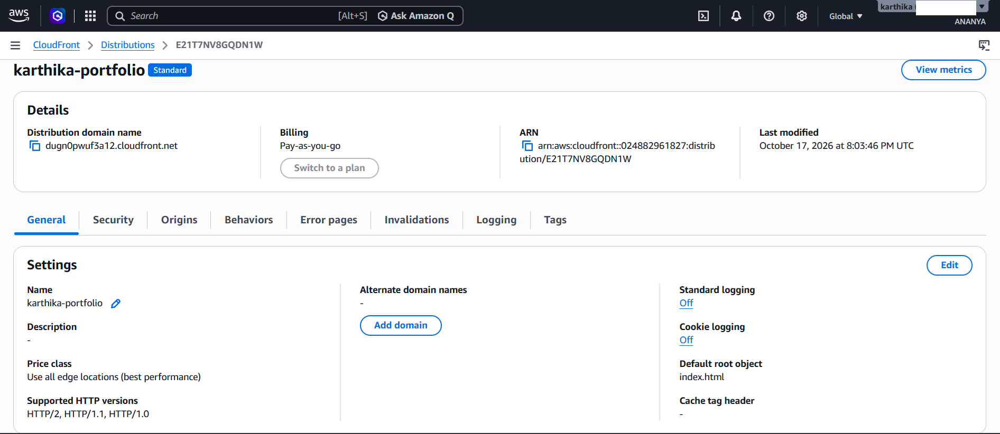
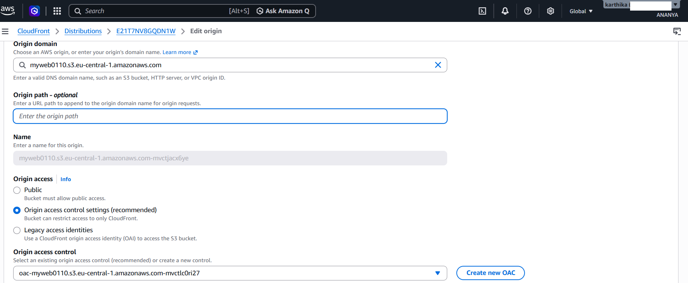
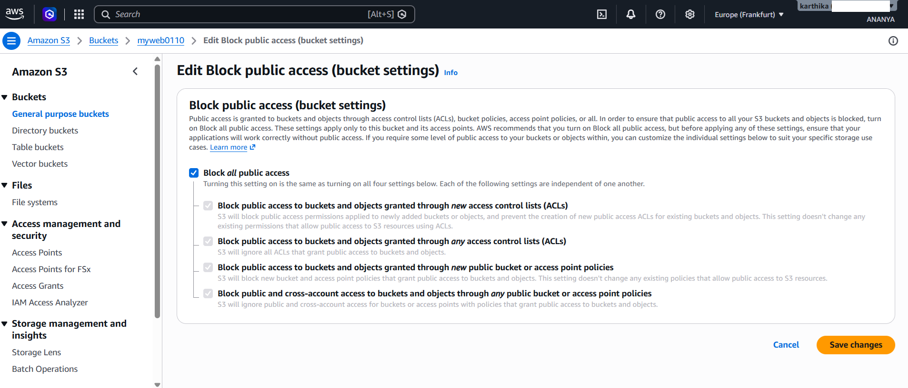
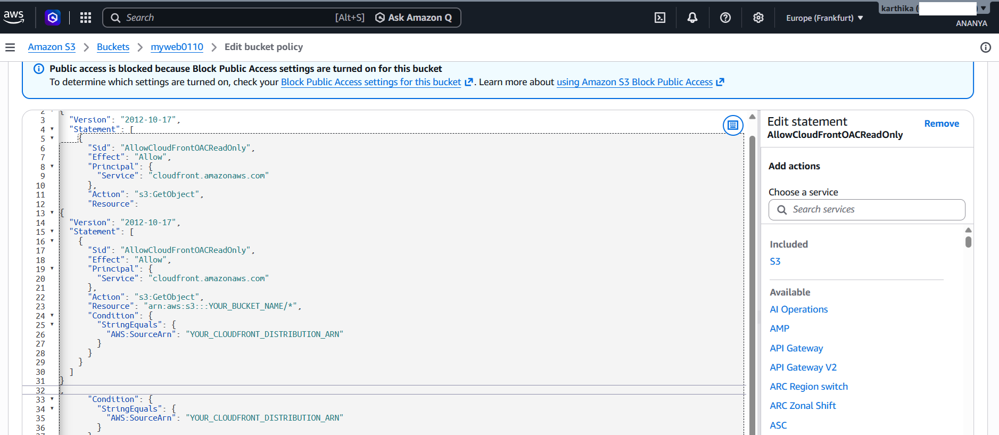

# AWS Static Website Hosting with Amazon S3 and CloudFront

## Project Overview

This project demonstrates how to host a static personal portfolio website using Amazon S3 and Amazon CloudFront.

The project focuses on secure content delivery, restricting direct public access to the S3 bucket, and documenting the architecture and deployment process.

**Project type:** AWS hands-on project
**Services:** Amazon S3, Amazon CloudFront, Origin Access Control (OAC)
**Location:** AWS Europe (Frankfurt), if applicable to the deployed resources

## Architecture

The editable architecture diagram is available here: [AWS Static Website Hosting.drawio](docs/architecture/AWS%20Static%20Website%20Hosting.drawio).

### Request Flow

1. A visitor opens the website through the CloudFront distribution URL.
2. CloudFront receives the HTTPS request.
3. CloudFront uses Origin Access Control (OAC) to authenticate requests to the private S3 origin.
4. The S3 bucket policy allows the required read access from the intended CloudFront distribution.
5. S3 returns the website files through CloudFront to the visitor.

## AWS Services Used

- **Amazon S3:** Stores the static website files.
- **Amazon CloudFront:** Delivers website content through a content delivery network.
- **Origin Access Control (OAC):** Allows CloudFront to securely access the S3 origin.
- **S3 bucket policy:** Restricts object access to the intended CloudFront distribution.

## Implementation

1. Created an S3 bucket to store the website files.
2. Uploaded the website's `index.html` file.
3. Created a CloudFront distribution using the regular S3 bucket origin.
4. Configured Origin Access Control with request signing enabled.
5. Configured the S3 bucket policy to allow the intended CloudFront distribution to retrieve objects.
6. Set `index.html` as the default root object.
7. Configured HTTP-to-HTTPS redirection.
8. Tested the website through the CloudFront distribution URL.

## Security Decisions

- Keep S3 Block Public Access enabled.
- Use CloudFront OAC instead of granting anonymous public access to the S3 bucket.
- Limit the bucket policy to the intended CloudFront distribution.
- Follow least-privilege access principles.
- Never commit AWS access keys, passwords, or other credentials to GitHub.

## Deployment Screenshots

### 1. CloudFront Distribution

### 2. CloudFront Origin Access Control

### 3. S3 Block Public Access

### 4. S3 Bucket Policy

## Cost Management and Cleanup

AWS resources may incur charges depending on usage and current pricing.

- Review AWS Billing and Cost Management regularly.
- Remove resources that are no longer needed.
- Before deleting the CloudFront distribution, save the required screenshots and confirm whether you still need the CloudFront URL.
- Delete the S3 bucket only after confirming that its contents are no longer needed.

Deleting the CloudFront distribution will stop the distribution URL from serving the website.

## Skills Demonstrated

- Static website hosting with Amazon S3
- Content delivery with Amazon CloudFront
- Origin Access Control configuration
- S3 bucket policy configuration
- Basic cloud security and least-privilege access
- AWS deployment testing and technical documentation
- GitHub repository management

